# 2026 #30DayMapChallenge

My maps for the [#30DayMapChallenge](https://30daymapchallenge.com/), November 1–30, 2026: one map a day, each with its own prompt. My goals for participating in this challenge is to improve my mapping skills using R, ArcGIS, and Python. 

Most maps are built from a few public datasets I keep coming back to, especially **NYC 311**. Daily posts go up on Bluesky at [@mel-likes-maps.bsky.social](https://bsky.app/profile/mel-likes-maps.bsky.social).

## The maps

Click a map to see the script behind it.

<table>
  <tr>
    <td align="center" width="33%">
      <a href="day01_points.R">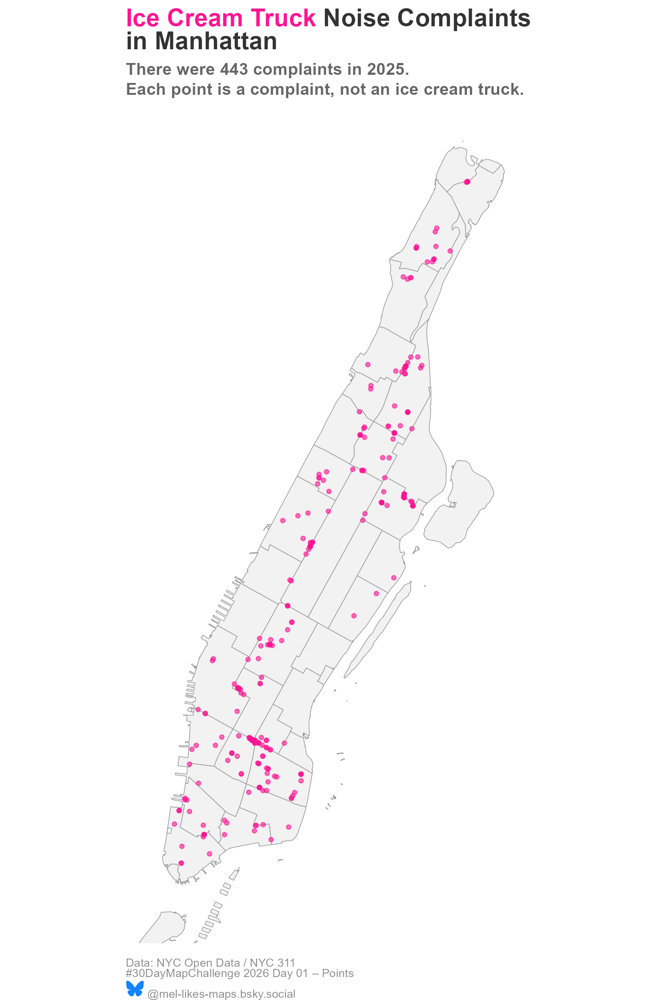</a> 
      <b>Day 1 · Points</b> 
      443 ice cream truck noise complaints in Manhattan
    </td>
    <td align="center" width="33%">
      <a href="day02_lines.R">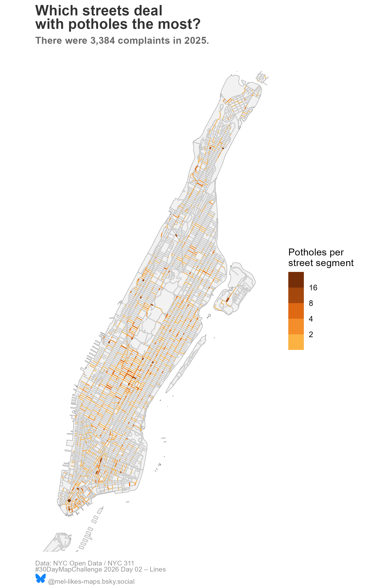</a> 
      <b>Day 2 · Lines</b> 
      Manhattan streets colored by pothole complaints
    </td>
    <td align="center" width="33%">
      <a href="day03_polygons.R">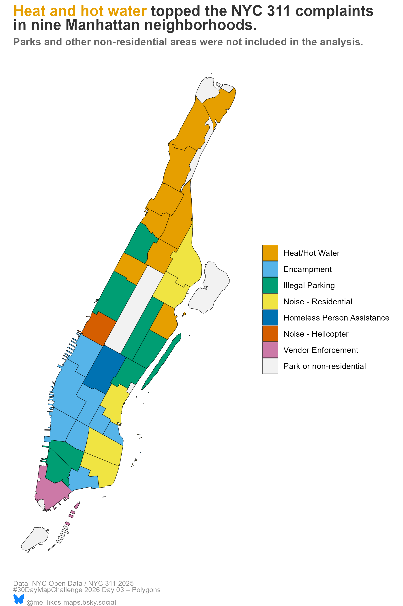</a> 
      <b>Day 3 · Polygons</b> 
      Each Manhattan neighborhood's top 311 complaint
    </td>
  </tr>
  <tr>
    <td align="center">
      <a href="day04_clusters.R">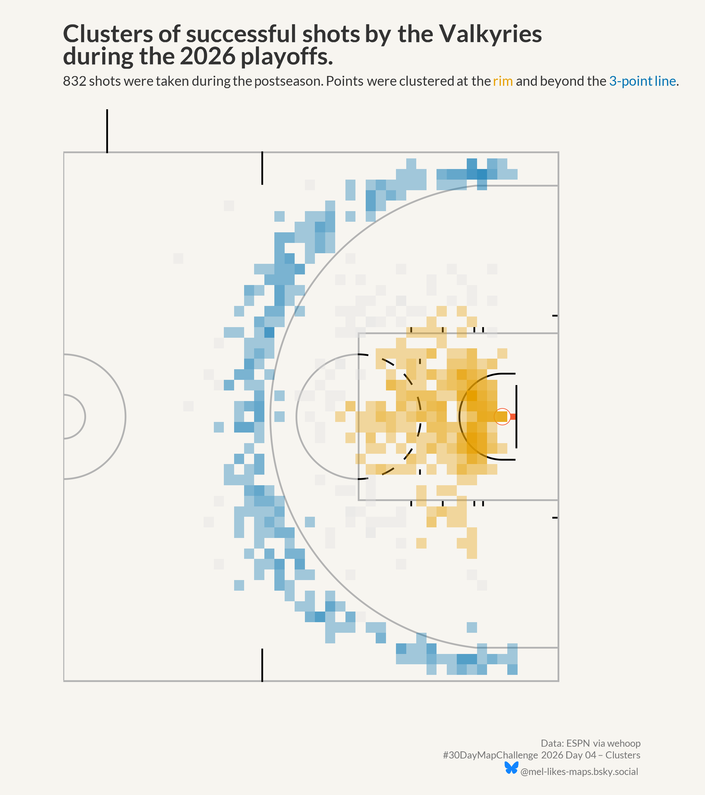</a> 
      <b>Day 4 · Clusters</b> 
      Valkyries' made shots in the 2026 WNBA playoffs
    </td>
    <td align="center">
      <a href="day05_sight.R">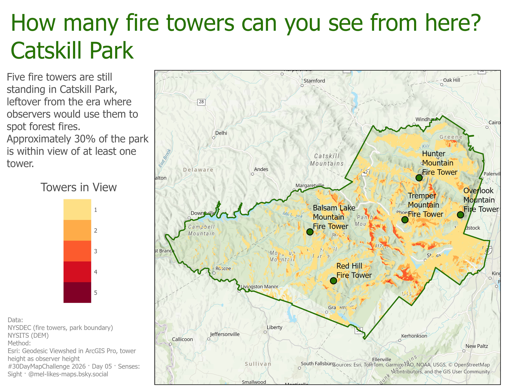</a> 
      <b>Day 5 · Senses: Sight</b> 
      How many Catskill fire towers can you see from here?
    </td>
    <td align="center">
      <a href="day06_vintage.R">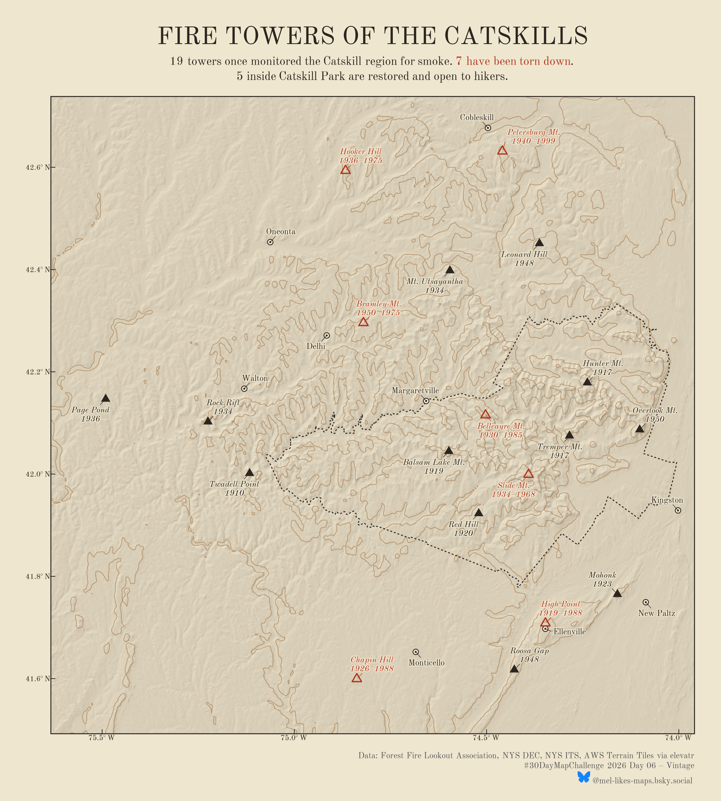</a> 
      <b>Day 6 · Vintage</b> 
      The Catskills' lost fire towers, 1930s topo style
    </td>
  </tr>
  <tr>
    <td align="center">
      <a href="day07_10minutes.R">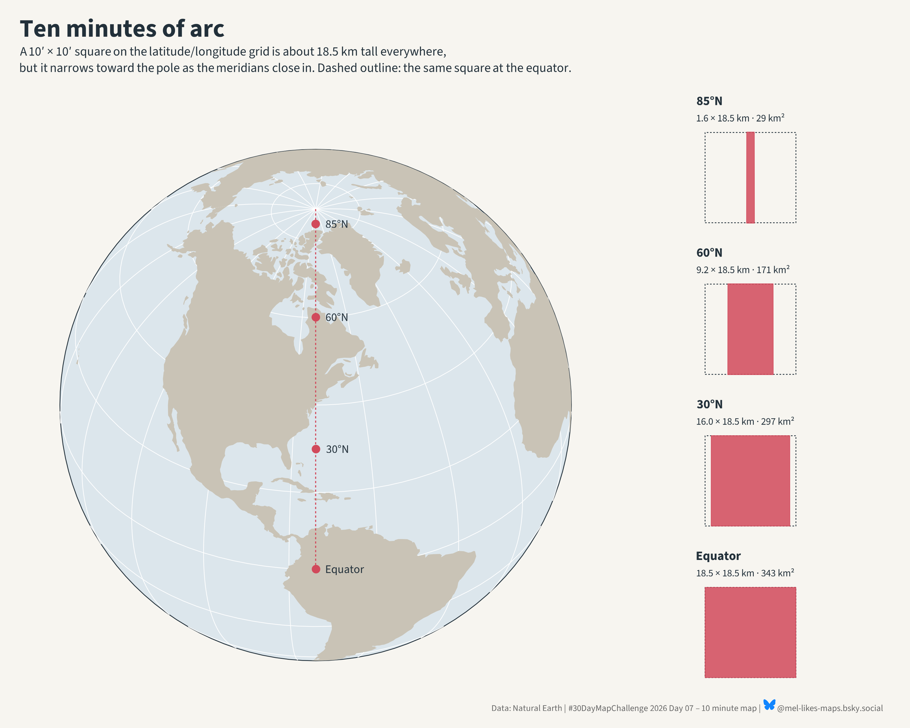</a> 
      <b>Day 7 · 10 minute map</b> 
      10 minutes of arc, from the equator to 85°N
    </td>
    <td align="center">
      <a href="day08_utopia.R">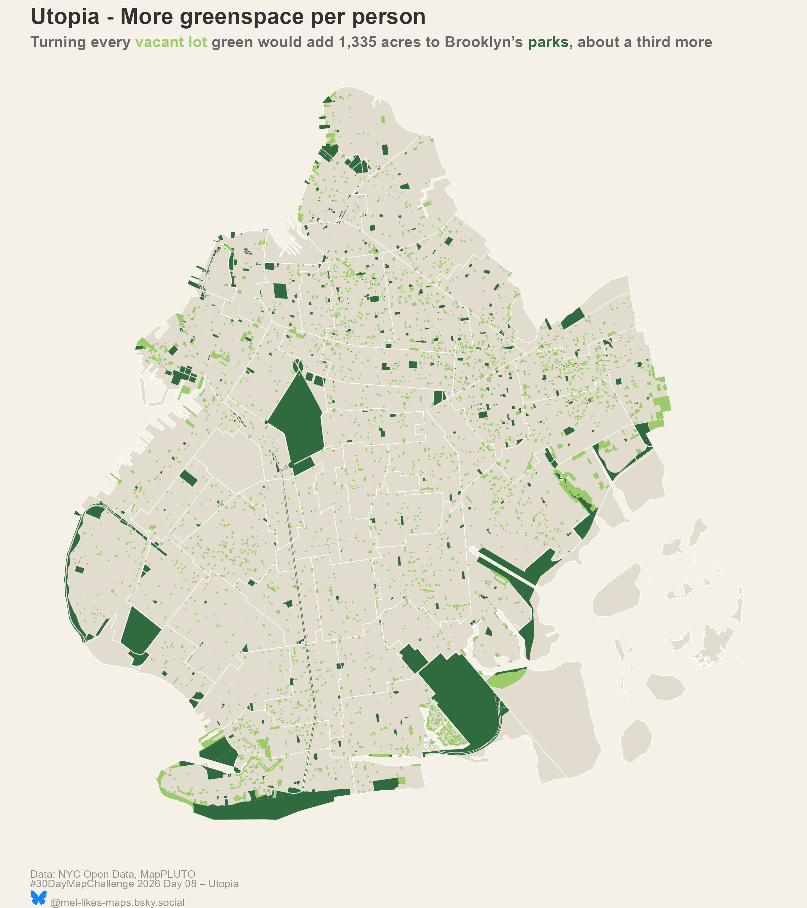</a> 
      <b>Day 8 · Utopia</b> 
      If every Brooklyn vacant lot became a park
    </td>
    <td align="center">
      <a href="day10_prompting.R">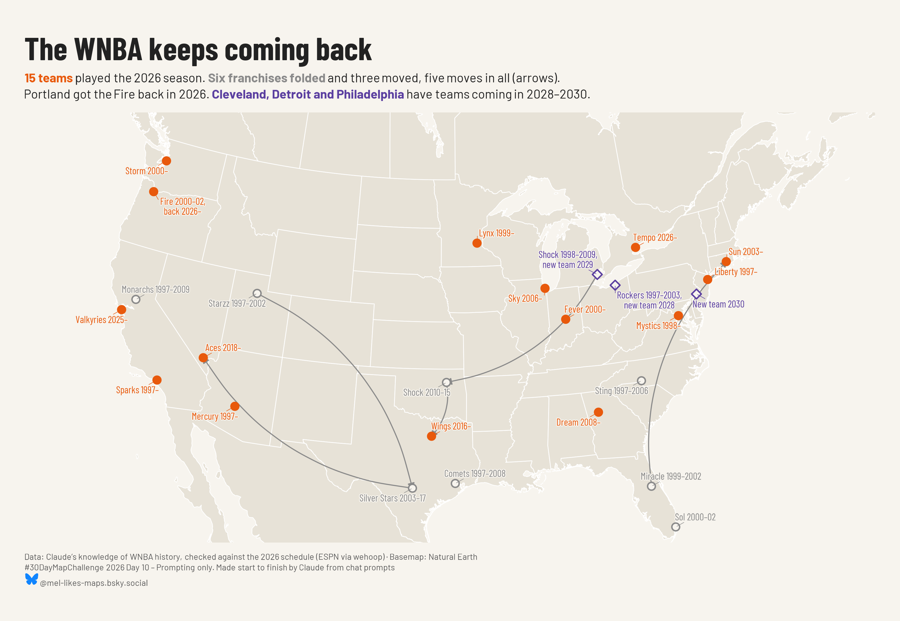</a> 
      <b>Day 10 · Prompting only</b> 
      WNBA franchises, past and present
    </td>
  </tr>
  <tr>
    <td align="center" width="33%">
      <a href="day11_sound.R">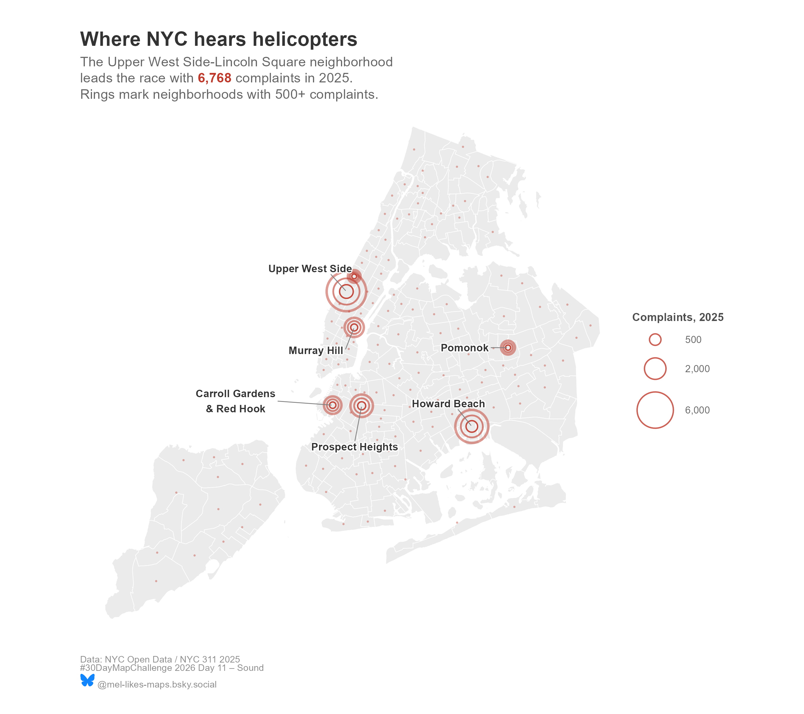</a> 
      <b>Day 11 · Senses: Sound</b> 
      Where NYC hears helicopters
    </td>
    <td align="center" width="33%">
      <a href="day13_interactions.R">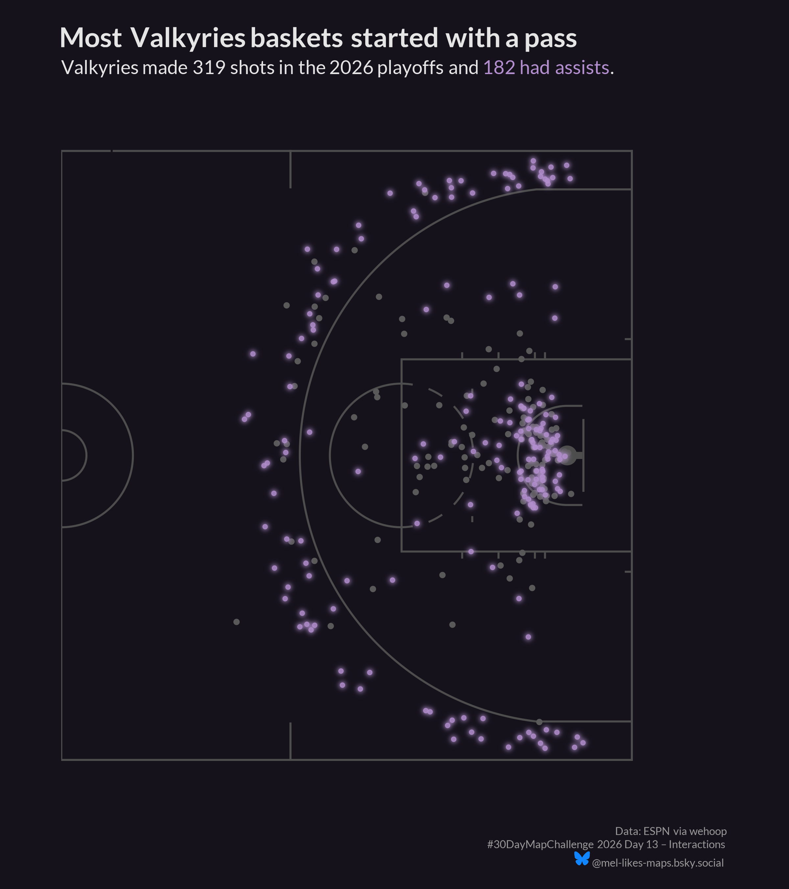</a> 
      <b>Day 13 · Interactions</b> 
      Most Valkyries baskets started with a pass
    </td>
    <td align="center" width="33%">
      <a href="day22_projections.R">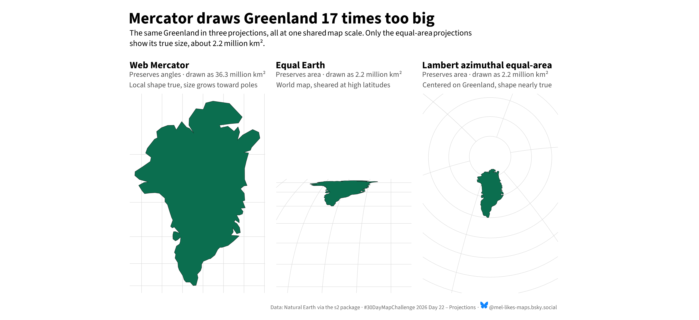</a> 
      <b>Day 22 · Projections</b> 
      Mercator draws Greenland 17 times too big
    </td>
  </tr>
</table>

More maps get added here as the month goes on.

## Tools

- **R:** sf, ggplot2, terra, ggtext, ggrepel, showtext, patchwork
- **Basketball data:** wehoop and sportyR
- **Effects:** ggfx for the Day 13 glow
- **Esri REST queries:** arcgislayers for MapPLUTO and Census blocks on Day 8
- **ArcGIS Pro:** the Day 5 viewshed. `day05_sight.R` is only the data prep, and the map itself was made in Pro.

## Data

| Data | Used on |
| :-- | :-- |
| [NYC 311 Service Requests](https://data.cityofnewyork.us/Social-Services/311-Service-Requests-from-2020-to-Present/erm2-nwe9) | Days 1, 2, 3, 11 |
| [NYC Neighborhood Tabulation Areas (2020)](https://data.cityofnewyork.us/resource/9nt8-h7nd) | Days 1, 2, 3, 8, 11 |
| [NYC Street Centerline](https://data.cityofnewyork.us/resource/inkn-q76z) | Day 2 |
| ESPN shot data via [wehoop](https://wehoop.sportsdataverse.org/) | Days 4, 10, 13 |
| NYS DEC fire towers and Catskill Park boundary, NYS ITS 10 m elevation | Day 5 |
| Forest Fire Lookout Association, NYS DEC, NYS ITS, AWS Terrain Tiles | Day 6 |
| Natural Earth (Days 7 and 22 via the s2 package) | Days 7, 10, 22 |
| [MapPLUTO](https://services5.arcgis.com/GfwWNkhOj9bNBqoJ/arcgis/rest/services/MAPPLUTO/FeatureServer/0) (NYC Dept. of City Planning), vacant lots | Day 8 |
| [NYC Parks Properties](https://data.cityofnewyork.us/d/enfh-gkve) | Day 8 |
| [Census TIGERweb 2020 blocks](https://tigerweb.geo.census.gov/arcgis/rest/services/TIGERweb/Tracts_Blocks/MapServer/12), population | Day 8 |

## How AI was used

I used AI (Claude) to review scripts I wrote and suggest improvements or design ideas. I also used it when I got stuck with certain functions or to discover new methods. Claude also keeps this page up to date. 

## Running the scripts

Each day has its own script, `dayNN_prompt.R`, and saves its map to `output/`. Raw data goes in `data/`, which isn't committed. Most scripts download what they need, and the 311 scripts read a saved 2025 pull (`data/nyc311_2025.csv`). The download step is commented out at the top of `day01_points.R`. Day 8 works the same way: it reads a saved pull of Brooklyn's vacant lots (`data/vacant_bk.rds`), and the download step is commented out at the top of `day08_utopia.R`.
